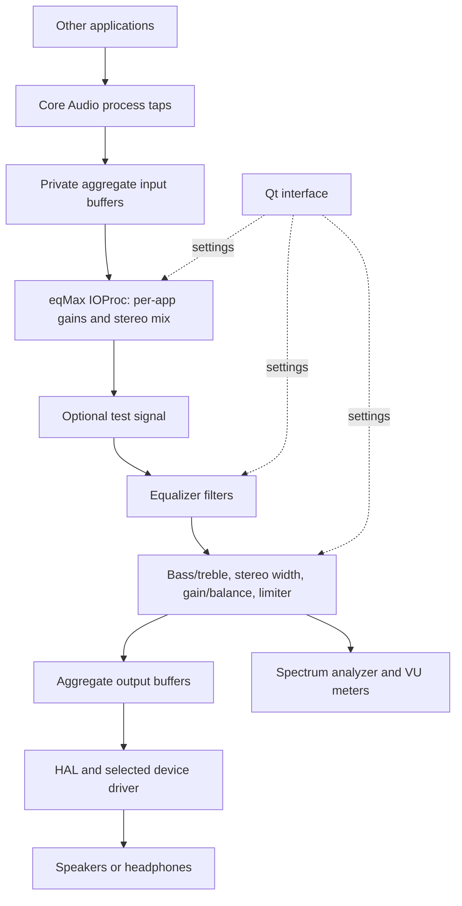

# eqMax macOS audio architecture: why the old path failed and how routing was fixed

Prepared 16 October 2026.

The routing change completes the connection between **other applications’ playback, eqMax’s DSP, and the selected speakers or headphones**. The earlier version could run processing callbacks, display input levels, and play generated signals without successfully processing system playback. The current version explicitly captures process audio and renders the processed result through one aggregate-device callback.

This document explains the macOS concepts, shows the earlier implementation’s missing connections, and traces the replacement through actual source excerpts.

## 1. Versions and evidence

“Old version” means commit `052e95faf6a3de1168d36245b952666f41871210`, dated 17 September 2026, with the message `fix: resolve audio routing by linking output IOProc rendering and dual input stream capture`. This is the latest committed revision at the time of writing. “Current version” means the modified working-tree files inspected on 16 October 2026. **The process-tap routing rewrite is still uncommitted.**

The immediately preceding commit, `6b6ef2e`, is included once to explain how the callback evolved. Claims about missing connections are based on source inspection. This document does not establish which executable was running when sound first worked, or report a new live capture/playback measurement.

Every excerpt below includes its original source line numbers. `123 |` is a display prefix, not part of the code. Current-file links lead to the source; historical code is embedded because the file at that path has since changed.

## 2. The macOS audio architecture

### 2.1 Core Audio, HAL, and the device driver

Core Audio is Apple’s audio infrastructure. Its **Hardware Abstraction Layer (HAL)** presents devices and streams through common interfaces, supplies timing information, and connects audio clients to hardware. Applications can use higher-level audio services or call the HAL interfaces directly. eqMax uses the latter approach through `AudioObjectGetPropertyData`, `AudioDeviceCreateIOProcID`, and `AudioDeviceStart`. Apple’s archived overview explains the Core Audio/HAL relationship. [Apple: Core Audio Overview](https://developer.apple.com/library/archive/documentation/MusicAudio/Conceptual/CoreAudioOverview/WhatisCoreAudio/WhatisCoreAudio.html)

A simplified ordinary playback path is:

```text
Application generates or decodes audio
    → Core Audio / HAL
    → selected device’s driver and hardware
    → speakers or headphones
```

Opening a device for playback lets eqMax supply its own audio. It does not automatically insert eqMax’s EQ into every other application’s path.

### 2.2 What an IOProc receives

An **IOProc** is a callback that the audio system invokes for each I/O cycle. Its two buffer arguments have different purposes:

| Argument | Meaning |
| --- | --- |
| `inInputData` | Samples supplied by the device’s enabled input streams. Their source depends on the device configuration. |
| `outOutputData` | Buffers the client fills with the samples it wants played. |

Apple specifies that output buffer memory is zeroed before the callback runs. Consequently, reading this output buffer cannot recover another application’s playback. [Apple: AudioDeviceIOProc](https://developer.apple.com/documentation/coreaudio/audiodeviceioproc?language=objc)

A stereo frame contains one left and one right sample. This implementation mixes into separate left/right `float` arrays, then maps those samples into the output buffers’ channel layout.

### 2.3 Process taps and aggregate devices

A **process tap** captures outgoing audio from specified processes. A **global tap** can capture processes while excluding a supplied list. Taps can also suppress the captured processes’ direct playback. An **aggregate device** exposes a group of audio sources/devices through one HAL device interface. Apple’s sample combines a tap with an aggregate so tapped audio becomes an input stream. These tap APIs require macOS 14.2 or later. [Apple: Capturing system audio with Core Audio taps](https://developer.apple.com/documentation/CoreAudio/capturing-system-audio-with-core-audio-taps)

In eqMax, the aggregate contains the process taps and the selected output device. Its callback can therefore receive captured playback and fill the destination’s output buffers in the same invocation. eqMax creates this aggregate privately and does not install a custom audio driver or change the system default output to its internal aggregate.

### 2.4 The current signal path



The aggregate’s inputs and outputs are parts of the same device interface. The arrows show the sample flow through eqMax, rather than separate physical devices at every step.

## 3. Why the previous version did not complete system-audio routing

### 3.1 It treated an output buffer as captured playback

The old output branch read `outOutputData` into scratch buffers before processing it:

Commit `052e95f`: `src/audio/AudioDeviceManager.mm`, lines 29–55.

```text
  29 |     // 1. Output Hardware Playback Loop (Plays audio OUT to Speakers / Headphones)
  30 |     if (outOutputData && outOutputData->mNumberBuffers > 0) {
  31 |         for (UInt32 b = 0; b < outOutputData->mNumberBuffers; ++b) {
  32 |             AudioBuffer& buf = outOutputData->mBuffers[b];
  33 |             if (buf.mData && buf.mDataByteSize > 0) {
  34 |                 auto* samples = static_cast<float*>(buf.mData);
  35 |                 UInt32 channels = std::max<UInt32>(1, buf.mNumberChannels);
  36 |                 UInt32 numFrames = buf.mDataByteSize / (sizeof(float) * channels);
  37 | 
  38 |                 std::vector<float> leftBuffer(numFrames, 0.0f);
  39 |                 std::vector<float> rightBuffer(numFrames, 0.0f);
  40 | 
  41 |                 // Read incoming samples from hardware or buffer
  42 |                 if (channels >= 2) {
  43 |                     for (UInt32 f = 0; f < numFrames; ++f) {
  44 |                         leftBuffer[f] = samples[f * 2];
  45 |                         rightBuffer[f] = samples[f * 2 + 1];
  46 |                     }
  47 |                 } else {
  48 |                     for (UInt32 f = 0; f < numFrames; ++f) {
  49 |                         leftBuffer[f] = samples[f];
  50 |                         rightBuffer[f] = samples[f];
  51 |                     }
  52 |                 }
  53 | 
  54 |                 // Execute DSP Engine (Test Generator, EQ Filters, Volume Boost/Attenuation, Limiter, Spectrum Analyzer)
  55 |                 manager->processAudioBlock(leftBuffer.data(), rightBuffer.data(), numFrames);
```

Here, `samples` points into the callback’s output buffer. The comment on line 41 describes it as incoming audio, but the buffer is initially zeroed according to the IOProc contract. EQ and gain applied to zeros still produce zeros. A test generator can add samples, so hearing a generated sine wave proves that output rendering works; it does not prove that another app’s music reached the EQ.

The same conceptual mistake existed before `052e95f`: the callback selected output data as its fallback source when input was unavailable:

Commit `6b6ef2e`: `src/audio/AudioDeviceManager.mm`, lines 29–35.

```text
  29 |     const AudioBufferList* srcBufList = (inInputData && inInputData->mNumberBuffers > 0 && inInputData->mBuffers[0].mData) 
  30 |                                         ? inInputData : outOutputData;
  31 |     if (!srcBufList || srcBufList->mNumberBuffers == 0) return noErr;
  32 | 
  33 |     for (UInt32 i = 0; i < srcBufList->mNumberBuffers; ++i) {
  34 |         const AudioBuffer& buf = srcBufList->mBuffers[i];
  35 |         if (buf.mNumberChannels >= 2 && buf.mData) {
```

Commit `052e95f` split this into explicit output and input branches and added mono handling. It improved callback coverage, but the replacement still read the output buffer as its playback source.

### 3.2 It opened the default input, which was not a system-playback tap

The old startup code selected the default input device:

Commit `052e95f`: `src/audio/AudioDeviceManager.mm`, lines 248–260.

```text
 248 |     // Detect Default Input Device
 249 |     if (inputDeviceId_ == 0) {
 250 |         AudioDeviceID defaultInput = 0;
 251 |         UInt32 size = sizeof(AudioDeviceID);
 252 |         AudioObjectPropertyAddress addr = {
 253 |             kAudioHardwarePropertyDefaultInputDevice,
 254 |             kAudioObjectPropertyScopeGlobal,
 255 |             kAudioObjectPropertyElementMain
 256 |         };
 257 |         if (AudioObjectGetPropertyData(kAudioObjectSystemObject, &addr, 0, nullptr, &size, &defaultInput) == noErr) {
 258 |             inputDeviceId_ = defaultInput;
 259 |             std::cout << "[AudioDeviceManager] Default Input Device ID: " << defaultInput << std::endl;
 260 |         }
```

It then registered a separate callback on that input device:

Commit `052e95f`: `src/audio/AudioDeviceManager.mm`, lines 275–284.

```text
 275 |     // Register IOProc on Input Device (Captures Apple Music / System Input / BlackHole)
 276 |     if (inputDeviceId_ > 0 && inputDeviceId_ != outputDeviceId_) {
 277 |         AudioDeviceID inDevId = static_cast<AudioDeviceID>(inputDeviceId_);
 278 |         AudioDeviceIOProcID inProcId = nullptr;
 279 |         OSStatus status = AudioDeviceCreateIOProcID(inDevId, CoreAudioIOCallback, this, &inProcId);
 280 |         if (status == noErr && inProcId) {
 281 |             audioInputProcHandle_ = reinterpret_cast<uintptr_t>(inProcId);
 282 |             AudioDeviceStart(inDevId, inProcId);
 283 |             std::cout << "[AudioDeviceManager] CoreAudio Hardware Input Capture IOProc started on device " << inDevId << std::endl;
 284 |         }
```

This captures whatever the selected input supplies, such as a microphone or a configured virtual loopback device. The comment mentioning Apple Music does not configure a loopback route. The old implementation never creates a process tap, so ordinary application playback is not explicitly captured.

Selecting a virtual input such as BlackHole could provide playback only if an external route had already sent playback there. That alone would still leave the next connection missing.

### 3.3 Captured input was processed and then discarded

The old input branch created callback-local scratch buffers:

Commit `052e95f`: `src/audio/AudioDeviceManager.mm`, lines 73–82.

```text
  73 |     if (inInputData && inInputData->mNumberBuffers > 0) {
  74 |         for (UInt32 b = 0; b < inInputData->mNumberBuffers; ++b) {
  75 |             const AudioBuffer& buf = inInputData->mBuffers[b];
  76 |             if (buf.mData && buf.mDataByteSize > 0) {
  77 |                 const auto* samples = static_cast<const float*>(buf.mData);
  78 |                 UInt32 channels = std::max<UInt32>(1, buf.mNumberChannels);
  79 |                 UInt32 numFrames = buf.mDataByteSize / (sizeof(float) * channels);
  80 | 
  81 |                 std::vector<float> leftBuffer(numFrames, 0.0f);
  82 |                 std::vector<float> rightBuffer(numFrames, 0.0f);
```

After copying the input into those buffers, it ended as follows:

Commit `052e95f`: `src/audio/AudioDeviceManager.mm`, lines 96–103.

```text
  96 |                 // Feed input stream to DSP & Spectrum Analyzer
  97 |                 manager->processAudioBlock(leftBuffer.data(), rightBuffer.data(), numFrames);
  98 |             }
  99 |         }
 100 |     }
 101 | 
 102 |     return noErr;
 103 | }
```

`processAudioBlock` modified those arrays and fed the analyzer. The branch did not copy them to output or enqueue them for the separate output callback. The arrays were destroyed when the callback returned. Even when input capture was valid, a moving analyzer therefore did not establish that the captured sound was being played back.

The old effective paths were:

```text
Default input → local arrays → DSP/analyzer → arrays discarded

Zeroed speaker-output buffers → DSP/test generator → speakers
```

There was no transfer between those paths. Independent input and output devices would also require explicit buffering and timing coordination if retained as a two-callback design.

### 3.4 The permission request addressed microphone capture

The earlier permission method used AVFoundation capture-device authorization:

Commit `052e95f`: `src/audio/AudioDeviceManager.mm`, lines 215–225.

```text
 215 | void AudioDeviceManager::requestAudioPermissions() {
 216 | #if defined(__APPLE__)
 217 |     [AVCaptureDevice requestAccessForMediaType:AVMediaTypeAudio completionHandler:^(BOOL granted) {
 218 |         if (granted) {
 219 |             std::cout << "[AudioDeviceManager] macOS Microphone/System Audio Permission GRANTED!" << std::endl;
 220 |         } else {
 221 |             std::cout << "[AudioDeviceManager] macOS Microphone/System Audio Permission DENIED." << std::endl;
 222 |         }
 223 |     }];
 224 | #endif
 225 | }
```

The log called this “Microphone/System Audio Permission,” but requesting access to an audio capture device does not create a process tap or a system-playback route. The current tap path requires the system-audio capture usage description and the corresponding authorization described in section 4.7.

### 3.5 Application volume settings were not connected to captured samples

The old mixer setter only changed an in-memory value:

Commit `052e95f`: `src/audio/AppVolumeManager.mm`, lines 53–60.

```text
  53 | void AppVolumeManager::setAppVolume(int pid, float volume) {
  54 |     std::lock_guard<std::mutex> lock(mutex_);
  55 |     appMap_[pid].volume = std::clamp(volume, 0.0f, 2.0f);
  56 | }
  57 | 
  58 | void AppVolumeManager::setAppMute(int pid, bool muted) {
  59 |     std::lock_guard<std::mutex> lock(mutex_);
  60 |     appMap_[pid].isMuted = muted;
```

The old audio callback had neither process-specific input streams nor a call to the mixer’s `getAppGain`. The UI could store a volume or mute value without that value changing another application’s audio. The current implementation connects those controls to actual tap samples.

## 4. How the current version fixes the path

### 4.1 Capture other processes explicitly and exclude eqMax

The router resolves eqMax’s own Core Audio process object and puts it in the exclusion list:

Current working tree: [src/audio/AudioDeviceManager.mm](../../src/audio/AudioDeviceManager.mm#L262), lines 262–270.

```text
 262 |     // Our own output must never be captured, or it would feed back into itself.
 263 |     AudioObjectID selfProcess = processObjectForPid(getpid());
 264 |     if (selfProcess == kAudioObjectUnknown) {
 265 |         std::cerr << "[AudioDeviceManager] Could not resolve own audio process object; refusing to create a global tap." << std::endl;
 266 |         return false;
 267 |     }
 268 | 
 269 |     NSMutableArray<NSDictionary*>* tapList = [NSMutableArray array];
 270 |     NSMutableArray<NSNumber*>* excluded = [NSMutableArray arrayWithObject:@(selfProcess)];
```

Excluding eqMax prevents its rendered audio from re-entering its own capture path. If the process object cannot be resolved, routing setup fails rather than building a global tap that might capture eqMax itself.

For applications with customized volume or mute, dedicated process taps are created. Those processes are excluded from the catch-all tap so they are not mixed twice:

Current working tree: [src/audio/AudioDeviceManager.mm](../../src/audio/AudioDeviceManager.mm#L291), lines 291–301.

```text
 291 |     for (const auto& proc : tapped) {
 292 |         CATapDescription* description = [[CATapDescription alloc] initStereoMixdownOfProcesses:@[ @(proc.objectId) ]];
 293 |         description.name = [NSString stringWithFormat:@"eqMax: %s (pid %d)", proc.appName.c_str(), proc.pid];
 294 |         if (createTap(description, owner->appVolumeManager_->gainControl(proc.appKey))) {
 295 |             [excluded addObject:@(proc.objectId)];
 296 |         }
 297 |     }
 298 | 
 299 |     CATapDescription* globalDescription = [[CATapDescription alloc] initStereoGlobalTapButExcludeProcesses:excluded];
 300 |     globalDescription.name = @"eqMax: All Other Apps";
 301 |     if (!createTap(globalDescription, nullptr)) return false;
```

### 4.2 Suppress original playback while a tap is consumed

All taps are created through this helper:

Current working tree: [src/audio/AudioDeviceManager.mm](../../src/audio/AudioDeviceManager.mm#L272), lines 272–287.

```text
 272 |     auto createTap = [&](CATapDescription* description, AppGainControl* gain) -> bool {
 273 |         description.privateTap = YES;
 274 |         description.muteBehavior = CATapMutedWhenTapped;
 275 |         description.UUID = [NSUUID UUID];
 276 |         AudioObjectID tapId = kAudioObjectUnknown;
 277 |         OSStatus status = AudioHardwareCreateProcessTap(description, &tapId);
 278 |         if (status != noErr || tapId == kAudioObjectUnknown) {
 279 |             std::cerr << "[AudioDeviceManager] Failed to create process tap '" << [description.name UTF8String]
 280 |                       << "' (OSStatus " << status << ")" << std::endl;
 281 |             return false;
 282 |         }
 283 |         slots.push_back({ tapId, gain, gain ? gain->effectiveGain() : 1.0f });
 284 |         [tapList addObject:@{
 285 |             @kAudioSubTapUIDKey: description.UUID.UUIDString,
 286 |             @kAudioSubTapDriftCompensationKey: @YES,
 287 |         }];
```

`CATapMutedWhenTapped` suppresses the original direct playback while the tap is being read. That allows the processed route to replace the original route audibly. Without suppression, original and processed sound could both reach the output, weakening the apparent EQ and potentially creating phase or echo effects. Tap drift compensation is requested in the aggregate’s tap-list entry.

### 4.3 Put tap inputs and the chosen output in one private aggregate

The router builds the aggregate with both components:

Current working tree: [src/audio/AudioDeviceManager.mm](../../src/audio/AudioDeviceManager.mm#L303), lines 303–314.

```text
 303 |     NSDictionary* aggregateDescription = @{
 304 |         @kAudioAggregateDeviceNameKey: @"eqMax Router",
 305 |         @kAudioAggregateDeviceUIDKey: [NSString stringWithFormat:@"com.eqmax.router.%@", [NSUUID UUID].UUIDString],
 306 |         @kAudioAggregateDeviceMainSubDeviceKey: outputUID,
 307 |         @kAudioAggregateDeviceIsPrivateKey: @YES,
 308 |         @kAudioAggregateDeviceIsStackedKey: @NO,
 309 |         @kAudioAggregateDeviceTapAutoStartKey: @YES,
 310 |         @kAudioAggregateDeviceSubDeviceListKey: @[ @{ @kAudioSubDeviceUIDKey: outputUID } ],
 311 |         @kAudioAggregateDeviceTapListKey: tapList,
 312 |     };
 313 | 
 314 |     OSStatus status = AudioHardwareCreateAggregateDevice((__bridge CFDictionaryRef)aggregateDescription, &aggregateId);
```

`outputUID` identifies the chosen output. The configuration names it as the main subdevice, includes it in the subdevice list, and attaches the taps through `tapList`. `kAudioAggregateDeviceIsPrivateKey` keeps the aggregate private to the creating process.

The IOProc is registered on this aggregate:

Current working tree: [src/audio/AudioDeviceManager.mm](../../src/audio/AudioDeviceManager.mm#L348), lines 348–353.

```text
 348 |     status = AudioDeviceCreateIOProcID(aggregateId, RoutingIOProc, this, &ioProcId);
 349 |     if (status != noErr || !ioProcId) {
 350 |         std::cerr << "[AudioDeviceManager] Failed to create IOProc (OSStatus " << status << ")" << std::endl;
 351 |         ioProcId = nullptr;
 352 |         return false;
 353 |     }
```

After stream setup, the aggregate is started:

Current working tree: [src/audio/AudioDeviceManager.mm](../../src/audio/AudioDeviceManager.mm#L369), lines 369–375.

```text
 369 |     status = AudioDeviceStart(aggregateId, ioProcId);
 370 |     if (status != noErr) {
 371 |         std::cerr << "[AudioDeviceManager] Failed to start routing IOProc (OSStatus " << status << ")" << std::endl;
 372 |         return false;
 373 |     }
 374 | 
 375 |     owner->routingActive_.store(true, std::memory_order_relaxed);
```

Where the included output device also has physical input streams, lines 355–366 configure IOProc stream usage to disable those inputs for this callback. The intended input sources are the taps, rather than an interface’s microphones.

### 4.4 Mix captured samples, process them, and write the result to output

The callback forwards both buffer lists into the same render function:

Current working tree: [src/audio/AudioDeviceManager.mm](../../src/audio/AudioDeviceManager.mm#L123), lines 123–133.

```text
 123 | static OSStatus RoutingIOProc(
 124 |     AudioObjectID inDevice,
 125 |     const AudioTimeStamp* inNow,
 126 |     const AudioBufferList* inInputData,
 127 |     const AudioTimeStamp* inInputTime,
 128 |     AudioBufferList* outOutputData,
 129 |     const AudioTimeStamp* inOutputTime,
 130 |     void* inClientData) {
 131 |     static_cast<AudioDeviceManager::Impl*>(inClientData)->render(inInputData, outOutputData);
 132 |     return noErr;
 133 | }
```

`render` first locates the destination stereo channels across the output buffers and clears those buffers (lines 138–158). It identifies the tap inputs and mixes into preallocated left/right arrays. The following excerpt contains the complete bridge from capture to playback:

Current working tree: [src/audio/AudioDeviceManager.mm](../../src/audio/AudioDeviceManager.mm#L160), lines 160–214.

```text
 160 |     // Tap streams follow the output device's own input streams, in tap-list order
 161 |     const UInt32 tapCount = static_cast<UInt32>(slots.size());
 162 |     const bool hasTaps = input && tapCount > 0 && input->mNumberBuffers >= tapCount;
 163 |     const UInt32 firstTap = hasTaps ? input->mNumberBuffers - tapCount : 0;
 164 | 
 165 |     for (UInt32 offset = 0; offset < totalFrames; offset += kMaxChunkFrames) {
 166 |         const UInt32 n = std::min<UInt32>(kMaxChunkFrames, totalFrames - offset);
 167 |         std::fill_n(mixL.data(), n, 0.0f);
 168 |         std::fill_n(mixR.data(), n, 0.0f);
 169 | 
 170 |         if (hasTaps) {
 171 |             for (UInt32 i = 0; i < tapCount; ++i) {
 172 |                 TapSlot& slot = slots[i];
 173 |                 const AudioBuffer& buf = input->mBuffers[firstTap + i];
 174 |                 const float targetGain = slot.gain ? slot.gain->effectiveGain() : 1.0f;
 175 |                 if (!buf.mData || buf.mDataByteSize == 0) {
 176 |                     slot.currentGain = targetGain;
 177 |                     continue;
 178 |                 }
 179 | 
 180 |                 const auto* samples = static_cast<const float*>(buf.mData);
 181 |                 const UInt32 channels = std::max<UInt32>(1, buf.mNumberChannels);
 182 |                 const UInt32 available = buf.mDataByteSize / (sizeof(float) * channels);
 183 |                 if (offset >= available) continue;
 184 |                 const UInt32 frames = std::min(n, available - offset);
 185 |                 const UInt32 rightOffset = channels > 1 ? 1 : 0;
 186 | 
 187 |                 // Linear gain ramp across the chunk to avoid zipper noise
 188 |                 float gain = slot.currentGain;
 189 |                 const float step = (targetGain - gain) / static_cast<float>(n);
 190 |                 for (UInt32 f = 0; f < frames; ++f) {
 191 |                     gain += step;
 192 |                     const UInt32 frame = (offset + f) * channels;
 193 |                     mixL[f] += samples[frame] * gain;
 194 |                     mixR[f] += samples[frame + rightOffset] * gain;
 195 |                 }
 196 |                 slot.currentGain = targetGain;
 197 |             }
 198 |         }
 199 | 
 200 |         // Test Generator, EQ Filters, Volume Boost/Attenuation, Limiter, Spectrum Analyzer
 201 |         owner->processAudioBlock(mixL.data(), mixR.data(), n);
 202 | 
 203 |         const bool sameChannel = outs[0].data == outs[1].data && outs[0].offset == outs[1].offset;
 204 |         for (size_t c = 0; c < outs.size(); ++c) {
 205 |             const ChannelLocation& loc = outs[c];
 206 |             if (!loc.data || offset >= loc.frames) continue;
 207 |             const UInt32 frames = std::min(n, loc.frames - offset);
 208 |             const float* mix = (c == 0) ? mixL.data() : mixR.data();
 209 |             for (UInt32 f = 0; f < frames; ++f) {
 210 |                 const float sample = sameChannel ? 0.5f * (mixL[f] + mixR[f]) : mix[f];
 211 |                 loc.data[(offset + f) * loc.stride + loc.offset] = sample;
 212 |             }
 213 |             if (sameChannel) break;
 214 |         }
```

The essential connections are now visible in one function:

- Lines 173–180 read each tap’s input buffer.
- Lines 174 and 187–196 apply each app’s effective gain with a gradual change across the chunk.
- Lines 193–194 accumulate the applications into a stereo mix.
- Line 201 processes that captured mix.
- Line 211 writes the processed sample into the actual output buffer.

This final write is connected to the captured samples. In the previous version, the input branch stopped after processing its local arrays.

### 4.5 Make the mixer controls affect the samples

Application gain and mute are stored atomically, allowing the audio callback to read them without taking the mixer map’s mutex:

Current working tree: [src/audio/AppVolumeManager.hpp](../../src/audio/AppVolumeManager.hpp#L17), lines 17–24.

```text
  17 | struct AppGainControl {
  18 |     std::atomic<float> volume{1.0f};  // 0.0 to 2.0 (200% boost)
  19 |     std::atomic<bool> muted{false};
  20 |     std::atomic<bool> customized{false}; // true once the user has touched this app's volume/mute
  21 | 
  22 |     [[nodiscard]] float effectiveGain() const noexcept {
  23 |         return muted.load(std::memory_order_relaxed) ? 0.0f : volume.load(std::memory_order_relaxed);
  24 |     }
```

The current volume setter updates this state and marks the application as customized:

Current working tree: [src/audio/AppVolumeManager.mm](../../src/audio/AppVolumeManager.mm#L244), lines 244–248.

```text
 244 | void AppVolumeManager::setAppVolume(const std::string& appKey, float volume) {
 245 |     AppGainControl* gain = gainControl(appKey);
 246 |     gain->volume.store(std::clamp(volume, 0.0f, 2.0f), std::memory_order_relaxed);
 247 |     gain->customized.store(true, std::memory_order_relaxed);
 248 | }
```

`checkRouting` selects customized Core Audio processes for dedicated taps (lines 223–231 of `AudioDeviceManager.mm`). Each tap slot holds the corresponding gain-control pointer. The render loop above reads `effectiveGain()` and multiplies the captured samples by it. Mute produces a target gain of zero. Multiple audio processes belonging to the same resolved application can share its gain state.

### 4.6 Run the DSP using the route’s sample rate and channel mapping

The current router reads the aggregate’s nominal sample rate and passes it to the EQ and effects engines:

Current working tree: [src/audio/AudioDeviceManager.mm](../../src/audio/AudioDeviceManager.mm#L337), lines 337–345.

```text
 337 |     {
 338 |         auto addr = globalAddress(kAudioDevicePropertyNominalSampleRate);
 339 |         Float64 rate = 0.0;
 340 |         UInt32 size = sizeof(rate);
 341 |         if (AudioObjectGetPropertyData(aggregateId, &addr, 0, nullptr, &size, &rate) == noErr && rate > 0.0) {
 342 |             owner->sampleRate_.store(static_cast<uint32_t>(rate), std::memory_order_relaxed);
 343 |             if (owner->eqEngine_) owner->eqEngine_->setSampleRate(static_cast<float>(rate));
 344 |             if (owner->effectsEngine_) owner->effectsEngine_->setSampleRate(static_cast<float>(rate));
 345 |         }
```

A filter’s coefficients depend on sample rate, so matching the processing to the route avoids tuning the filters for a different rate. This code reads the rate during routing construction; it does not establish continuous handling of every later rate change.

Lines 321–334 query the output device’s preferred stereo channels and validate them against the aggregate’s output channel count. `render` uses channel stride and offset when writing samples, and averages left/right for a single destination channel. This replaces the earlier assumption that the first two interleaved samples always represented the desired output pair.

The DSP stages themselves are called in this order:

Current working tree: [src/audio/AudioDeviceManager.mm](../../src/audio/AudioDeviceManager.mm#L635), lines 635–655.

```text
 635 | void AudioDeviceManager::processAudioBlock(float* left, float* right, size_t numFrames) noexcept {
 636 |     if (!left || !right || numFrames == 0) return;
 637 | 
 638 |     // 1. Generate test signal if enabled
 639 |     generateTestSignal(left, right, numFrames);
 640 | 
 641 |     // 2. Run Equalizer Filters Cascade
 642 |     if (eqEngine_) {
 643 |         eqEngine_->processStereo(left, right, numFrames);
 644 |     }
 645 | 
 646 |     // 3. Run Pro Effects (Volume Boost, Limiter, Balance, 3D Surround, Bass/Treble Enhancer)
 647 |     if (effectsEngine_) {
 648 |         effectsEngine_->processStereo(left, right, numFrames);
 649 |     }
 650 | 
 651 |     // 4. Feed Spectrum Analyzer & VU Meter
 652 |     if (spectrumAnalyzer_) {
 653 |         spectrumAnalyzer_->pushSamples(left, right, numFrames);
 654 |     }
 655 | }
```

Within `ProEffectsEngine::processStereo`, the order is bass/treble enhancement, mid-side stereo width, gain/balance, then the optional stereo-linked limiter (`src/dsp/ProEffectsEngine.cpp`, lines 63–91). Analyzer samples are collected after processing; they observe the output mix and are not an intermediate playback device.

### 4.7 Declare system-audio capture access and sign the bundle

The current bundle declares the tap capture usage description:

Current working tree: [macOS/Info.plist.in](../../macOS/Info.plist.in#L27), lines 27–32.

```text
  27 |     <key>LSMinimumSystemVersion</key>
  28 |     <string>14.2</string>
  29 |     <key>NSHighResolutionCapable</key>
  30 |     <true/>
  31 |     <key>NSAudioCaptureUsageDescription</key>
  32 |     <string>eqMax captures system audio so it can equalize it and control the volume of each application.</string>
```

Apple requires `NSAudioCaptureUsageDescription` for tap capture and documents the permission prompt when recording first starts from an aggregate containing a tap. [Apple: Capturing system audio with Core Audio taps](https://developer.apple.com/documentation/CoreAudio/capturing-system-audio-with-core-audio-taps)

The current `requestAudioPermissions` method opens the relevant System Settings pane instead of requesting microphone access (`AudioDeviceManager.mm`, lines 555–561). CMake also adds an ad-hoc bundle signing step:

Current working tree: [CMakeLists.txt](../../CMakeLists.txt#L119), lines 119–128.

```text
 119 | # Re-sign the whole bundle (ad-hoc) so Info.plist is sealed; macOS privacy (TCC) prompts
 120 | # for system audio capture rely on a valid bundle signature.
 121 | if(APPLE)
 122 |     find_program(CODESIGN_EXECUTABLE codesign)
 123 |     if(CODESIGN_EXECUTABLE)
 124 |         add_custom_command(TARGET eqMax POST_BUILD
 125 |             COMMAND ${CODESIGN_EXECUTABLE} --force --sign - $<TARGET_BUNDLE_DIR:eqMax>
 126 |             COMMENT "Ad-hoc signing eqMax.app"
 127 |         )
 128 |     endif()
```

Signing is a packaging change supporting the bundle’s privacy identity. It is not a substitute for creating the audio route or obtaining permission. Source inspection establishes that this step was added; it does not prove that an invalid signature was the specific cause of an earlier failed run.

## 5. Threads, route changes, and cleanup

The implementation has three main execution contexts:

| Context | Responsibilities | Source |
| --- | --- | --- |
| Qt UI thread | Controls, presets, device selection, and meter drawing; publishes processing settings. | `src/main.cpp`, `src/ui/MainWindow.cpp` |
| Serial routing queue | Enumerates relevant processes; creates, rebuilds, and destroys taps and the aggregate. | `AudioDeviceManager.mm`, lines 85–86, 218–247 |
| Core Audio callback | Reads tap buffers, applies app gains, runs DSP, and fills output buffers. | `AudioDeviceManager.mm`, lines 123–216 |

The route listens for changes to the default output, Core Audio process list, and device list (lines 404–414). A 500 ms poll checks for customizations that require a dedicated tap (lines 416–423). `checkRouting` rebuilds when the requested output or set of dedicated process taps changes. Existing gain values can be read directly by the callback without rebuilding the route on every slider movement.

Scratch mixing arrays are allocated when `Impl` is constructed and reused in chunks of at most 4,096 frames. This removes the old callback’s per-buffer `std::vector` allocation. EQ coefficient changes are applied on the audio thread at block boundaries; the EQ uses `try_lock` to avoid waiting for a pending UI configuration (`EqualizerEngine.cpp`, lines 65–83).

Cleanup stops and destroys the IOProc, destroys the aggregate, and then destroys the process taps (`AudioDeviceManager.mm`, lines 383–401). Destroying the taps removes the tap-based suppression of other apps’ original playback. Route rebuilding performs teardown before constructing the replacement, so switching routes can briefly interrupt processing.

## 6. Before and after

| Requirement | Old committed implementation | Current working implementation |
| --- | --- | --- |
| Obtain other apps’ playback | Reads output buffers or a selected input device; no process-tap setup. | Explicit Core Audio process taps. |
| Carry captured samples into playback | Input-local buffers are discarded after DSP. | One aggregate IOProc reads, processes, and writes the captured mix. |
| Avoid hearing the original alongside the EQ | No interception or suppression of other apps’ playback. | `CATapMutedWhenTapped`. |
| Avoid capturing eqMax’s own output | No global process capture existed. | eqMax’s process object is excluded from the global tap. |
| Apply per-app controls | Stores settings without applying them in the audio callback. | Dedicated tap samples are multiplied by shared gain state. |
| Match DSP to the route | No startup synchronization from the actual route in the old `start`. | Reads aggregate rate and updates EQ/effects during setup. |
| Address capture permissions | AVFoundation capture-device request and microphone usage description. | System-audio capture usage description and settings link. |
| Respond to route changes | Device setters stop/restart individual device callbacks. | Listeners and polling drive aggregate-route rebuilding. |

The decisive functional fix is the sample connection shown in section 4.4. The permission, channel-layout, sample-rate, and lifecycle changes support that complete route.

## 7. What the source establishes, and what still needs runtime verification

The current source contains a complete intended capture/process/render path. The old committed source contains the specific gaps shown above. Establishing performance and device compatibility requires running that path with actual audio hardware.

A successful generator test checks output and DSP; a successful music/EQ test additionally checks tap capture and replacement of the original playback. `routingActive_` is set after `AudioDeviceStart` succeeds, so that flag alone does not prove nonzero samples are flowing or that permission is effective.

The renderer assumes tap buffers follow the physical-device inputs in tap-list order and interprets samples as `float`. Those are implementation assumptions to check for supported configurations. Also, `SpectrumAnalyzer::pushSamples` still takes a mutex shared with FFT processing (`src/dsp/SpectrumAnalyzer.cpp`, lines 40–46 and 70–71). The route therefore should not be described as completely lock-free or proven glitch-free.

The current routing check caches the last attempted output/process configuration. A failed attempt with that same configuration is not automatically retried by the poll; the UI’s routing restart action performs a stop/start. These limits do not change the explanation of the original missing capture-to-output connection.

## 8. References and reproducing the comparison

### Apple references

- [Core Audio Overview](https://developer.apple.com/library/archive/documentation/MusicAudio/Conceptual/CoreAudioOverview/WhatisCoreAudio/WhatisCoreAudio.html): the relationship between Core Audio, HAL, and hardware. This is an archived conceptual reference; the tap API details come from the current sample below.
- [AudioDeviceIOProc](https://developer.apple.com/documentation/coreaudio/audiodeviceioproc?language=objc): callback input/output semantics and initially zeroed output buffers.
- [Capturing system audio with Core Audio taps](https://developer.apple.com/documentation/CoreAudio/capturing-system-audio-with-core-audio-taps): process capture, tap inputs in aggregates, muting, macOS 14.2+, and capture permission requirements.

### Repository comparison

Run these commands from the repository root to inspect the historical source without changing the checkout:

```bash
git show 052e95f:src/audio/AudioDeviceManager.mm | nl -ba
git show 052e95f:src/audio/AppVolumeManager.mm | nl -ba
git show 6b6ef2e:src/audio/AudioDeviceManager.mm | nl -ba
git show 052e95f -- src/audio/AudioDeviceManager.mm
git diff 052e95f -- src/audio/AudioDeviceManager.mm src/audio/AppVolumeManager.mm
git diff 052e95f -- CMakeLists.txt macOS/Info.plist.in
```

The numbered excerpts preserve the relevant code in this document even when current-file line numbers move. Current source snapshots used for the embedded excerpts have the following SHA-256 digests:

| Working-tree file | SHA-256 at writing |
| --- | --- |
| `CMakeLists.txt` | `0ecb03dfbc6794bcf05a23a12518eeabac0ea230cea2a1be1e8b95c64bee6990` |
| `macOS/Info.plist.in` | `57a27bb25ab96ee031385f82c680307866925d30ab2d2fc6b2532d1f938b624c` |
| `src/audio/AppVolumeManager.hpp` | `fdc28cf85c68dd995ce483c30f7306e83131d31dc2ffc95448bc02c1f4d31e62` |
| `src/audio/AppVolumeManager.mm` | `e9cb5d4fbc284d7f2465c3f321907c55dd4ff492997c39b308da6a5d29efba07` |
| `src/audio/AudioDeviceManager.mm` | `c146269766614cb0f6e10817d1e1bd93b1ec7395f24be8776caa1f821af9ca97` |
